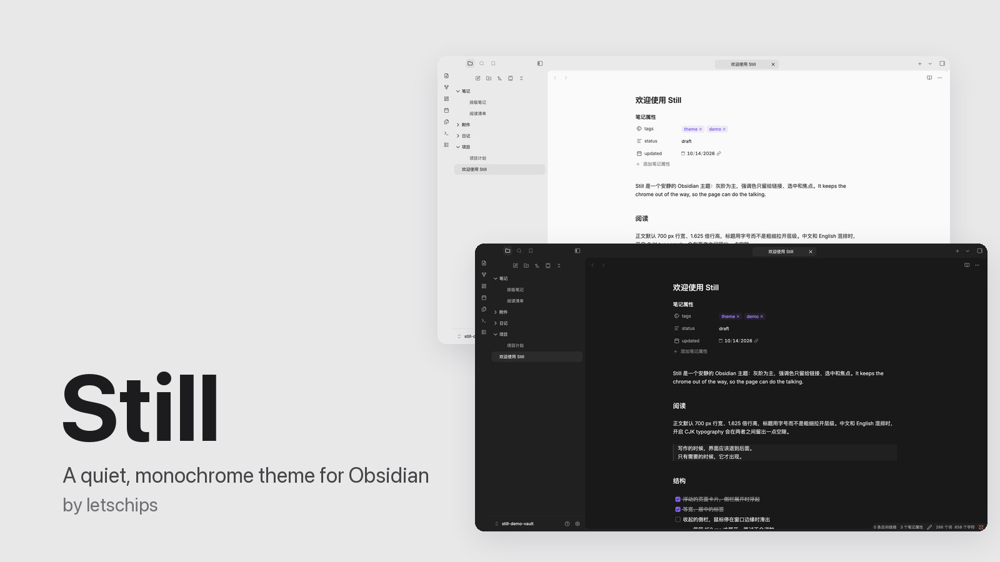
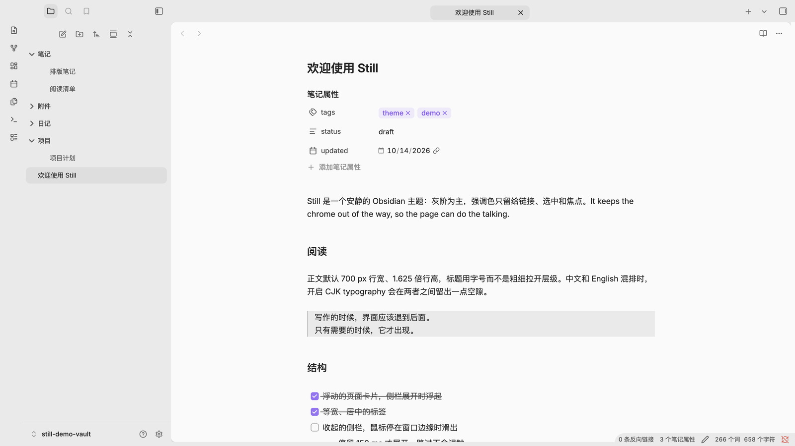
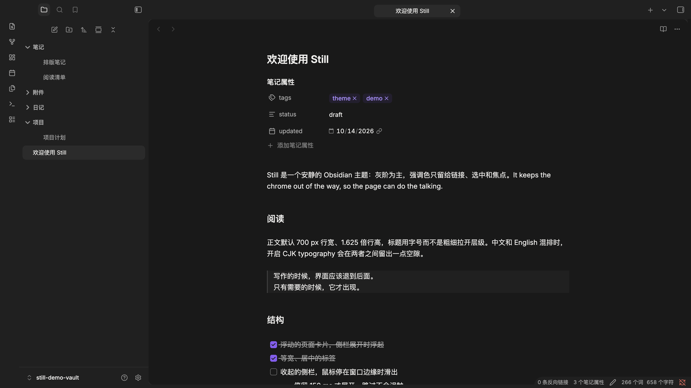
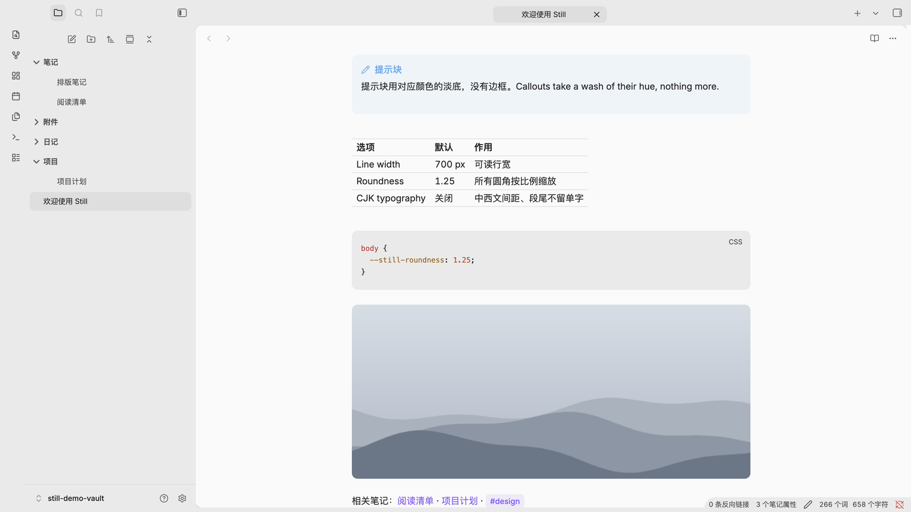
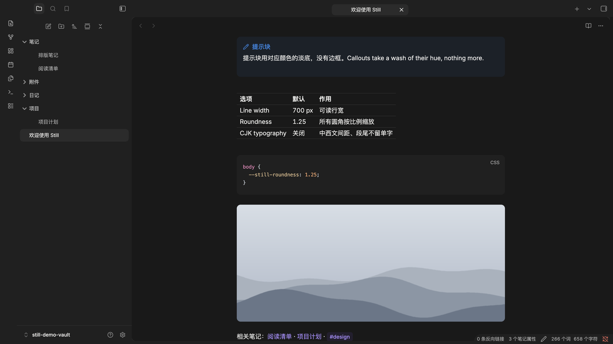

Still is a quiet, monochrome theme for Obsidian. Neutral greys carry the structure, hairlines replace heavy borders, and the accent color you pick in Obsidian is the only color the interface adds.

## Highlights

- **Floating page.** With a sidebar open, the page lifts off the frame as a rounded card.
- **Floating tabs.** Equal-width tabs with centered titles, centered above the page.
- **Sidebar peek.** Collapse a sidebar and rest the pointer on the window edge: it slides in, and slides away when you leave.
- **Calm reading.** A readable line length, light headings, block quotes, washed callouts and hairline tables.
- **Task states.** `[>]` `[<]` `[?]` `[!]` `[*]` `[-]` `[/]` each get their own mark instead of reading as done.
- **CJK typography** (optional). A gap where Chinese meets Latin letters or digits, and improved paragraph endings. iOS keeps normal paragraph wrapping.
- **Light to render.** No interface blur, 3D transforms or body-wide `:has()`, so typing and scrolling stay fast.

| Light | Dark |
| --- | --- |
|  |  |
|  |  |

## Options

Install [Style Settings](https://github.com/obsidian-community/obsidian-style-settings) to adjust line width and spacing, colors, roundness, tabs, sidebar peek, quiet toolbars and more. Every switch is off by default, and option names appear in Chinese when Obsidian is in Chinese. See [all options](./docs/OPTIONS.md).

Add these to a note's `cssclasses` property (the names match Minimal's):

| Class | Effect |
| --- | --- |
| `wide` | A wider line for tables, dashboards and image-heavy notes |
| `max` | The line fills the pane |
| `img-grid` | Images on consecutive lines share a row, in reading view |
| `table-small`, `table-tiny` | Smaller table text |
| `table-nowrap` | Table cells stay on one line |
| `table-numbers` | Numbered table rows |
| `row-alt` | A faint wash on every other table row |
| `col-lines`, `table-lines` | Rules between columns; a full grid with an outer frame |
| `table-center` | Narrow tables sit in the middle |
| `table-wide` | Tables (and embedded Bases) spread wider than the text, up to the pane; the text keeps its width |
| `img-wide` | Images without a set width spread wider than the text in the same way; with `img-grid`, single images still widen |
| `embed-strict` | Note embeds read as part of the text, without a frame or title |

Try them in the [example note](./docs/Still%20example.md): copy it into a vault and switch between reading view and Live Preview.

Task states, in reading view and the editor:

| Write | Shows |
| --- | --- |
| `- [>]` | Forwarded |
| `- [<]` | Scheduled |
| `- [?]` | Question |
| `- [!]` | Important |
| `- [*]` | Star |
| `- [-]` | Cancelled (struck and faded) |
| `- [/]` | In progress (half-filled box) |

## Install

In Obsidian, open **Settings → Appearance → Themes → Manage**, search for **Still**, then install and use it. Requires Obsidian 1.14.0 or later.

Accent color and fonts follow **Settings → Appearance**. Still is opaque and works alongside a window-translucency snippet on macOS.

## Links

[Changelog](./CHANGELOG.md) · [Contributing](./CONTRIBUTING.md) · [License (MIT)](./LICENSE)

Still is an original theme; no code from other themes is bundled. Its direction draws on [whirl](https://github.com/whirlchat/whirl) (tonal ladder, hairlines, motion), [Baseline](https://github.com/svnaxis/obsidian-baseline) (floating page and tabs, sidebar peek, card callouts) and [Minimal](https://github.com/kepano/obsidian-minimal) (per-note classes), all MIT-licensed.

---

## 中文简介

Still 是一个安静的单色 Obsidian 主题：灰阶构成层次，细线代替粗边框，界面里唯一的颜色是你在 Obsidian 里选的强调色。

- 侧栏展开时页面浮起成卡片；标签等宽居中；收起的侧栏，鼠标停在窗口边缘就会滑出。
- 可选的**中文排版**：中英文、数字之间自动留空隙，优化段落断行；iOS 正文保留普通换行。
- 安装 Style Settings 后可调行宽、颜色、圆角、标签、侧栏等；开关类选项默认关闭，界面语言为中文时显示中文名称。
- 在笔记属性 `cssclasses` 里写 `wide`、`max`、`img-grid`，可以单独加宽这篇笔记或把图片排成网格；表格类 `table-small`、`table-tiny`、`table-nowrap`、`table-numbers`、`row-alt`、`col-lines`、`table-lines`、`table-center`、`table-wide` 调整这篇笔记里的表格（`table-wide` 让表格和内嵌 Bases 比正文更宽，正文宽度不变）；`img-wide` 让图片同样加宽，`embed-strict` 让嵌入的笔记去掉底色、竖线和标题，像正文一样衔接。可以把[示例笔记](./docs/Still%20example.md)复制到库里直接试。
- 任务状态：`[>]` 转出、`[<]` 已排期、`[?]` 疑问、`[!]` 重要、`[*]` 星标、`[-]` 取消、`[/]` 进行中，各有自己的标记，不再都显示成已完成。
- 安装：设置 → 外观 → 主题 → 管理，搜索 **Still**。需要 Obsidian 1.14.0 或更高版本。
